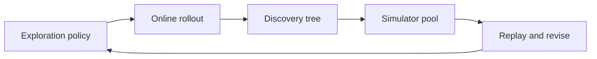

# Daydream

An independent implementation of [Dream-RSI: Recursive Self-Improvement through Evolving Worlds](https://arxiv.org/abs/2609.14858) (Zheng et al., 2026).

The official repository, [zhengkid/Dream-RSI](https://github.com/zhengkid/Dream-RSI), publishes the paper and the project page. As of this writing its release plan still lists the codebase, discovered programs, and reproduction scripts as in preparation. This project implements that missing loop so it can be run locally. It is not the authors' code, it is not affiliated with Google or the authors, and it does not reproduce their Gemini results.

Paper: [arXiv:2609.14858](https://arxiv.org/abs/2609.14858) · Project page: [dream-rsi.com](https://www.dream-rsi.com)

## What the method is

Discovery gets expensive because judging an exploration policy means watching it steer a whole run. Dream-RSI treats a finished run as a world that has already been paid for. The run is a tree: the root is the initial workspace, and every other node is one generation–evaluation attempt with its score stored on it.

The same policy interface is used in two places.

1. **Online explore.** The current policy picks a batch of branches to continue. A fixed discovery agent proposes a candidate from each parent, and a fixed evaluator scores it. The policy code does not change during the rollout.
2. **Construct a replay simulator.** The finished tree is appended to a pool. Replaying another policy only reveals nodes that are already stored. The agent and the evaluator are not called.
3. **Dream a better policy.** A fast model reads the stored branches and proposes one adaptive policy. That proposal is kept when its replay score wins; otherwise a small grid of revisions is scored. The score in this repository is

   `quality − λ_cost · attempts + λ_parallel · attempts / max(1, rounds)`

   `quality` is the best revealed score, `attempts` is how many nodes were revealed, and the last term rewards larger batches. The current policy is one of the candidates, so the one that is deployed next is never worse on this replay score. The next online round uses it, and the new tree widens the pool.

A replay can only walk branches that some earlier policy actually evaluated. That limit is why the loop has to go back online.



## What is in this repository

| Piece | Here |
| --- | --- |
| Discovery tree, batch decision interface, online rollout | Yes |
| Replay simulator and the Section 3 score | Yes |
| Monotone policy selection over a history pool | Yes |
| Parallel-refine starting policy, and a prefix-only adaptive policy | Yes |
| Fixed-exploration baseline (same agent, evaluator, and round-1 policy) | Yes |
| Sum–difference, circle packing, discretized autocorrelation, a small Lasso path, LayerNorm | Local evaluators, not the paper's scale |
| Optional OpenAI-compatible chat client for proposals and policy specs | Yes, off unless you opt in |
| The authors' Gemini CLI harness, KernelBench GPU runs, and the discovered C++ solver | No |

The default dreamer is `system1`: one pass over the recorded branches, then a replay check. `--dreamer grid` scores the full revision schedule instead. Neither path executes model-written Python. A policy module you wrote yourself can be loaded from disk; see `examples/narrow_policy.py`.

## Assumptions

This is a single-operator local runner, not a service.

- A run is one process. History is JSON on disk and fits in memory (thousands of nodes, not billions).
- A round is consistent when it finishes: the tree is appended only after that rollout returns. Replay never sees a partial round.
- Within a decision batch the attempts do not observe each other. They run in batch order so a seed determines the tree. `max_parallelism` is the batch cap the score treats as parallel workers.
- Replay is exact on the recorded tree and refuses to invent a child that was never evaluated.
- Chat calls, when enabled, have a timeout and retry transport failures only. `OPENAI_API_KEY` stays in the environment.
- A proposal or evaluator that raises is stored as a failed node with score 0. The run continues.

Every task stores a higher-is-better score. Autocorrelation keeps the peak in diagnostics and stores its inverse.

## Run it

Python 3.11 or newer. No third-party packages are required to run. Tests use pytest.

```bash
python -m venv .venv
source .venv/bin/activate
pip install -e ".[dev]"

daydream compare --task branch-world --rounds 2
pytest
```

`branch-world` is a small stand-in with dead branches and one branch that pays off only at depth 4. It is not a result from the paper. On this machine the compare looks like:

```text
fixed exploration
round   calls     cum      best  policy
    1      48      48    0.9500  parallel_refine
    2      48      96    0.9500  parallel_refine

dream-rsi
round   calls     cum      best  policy
    1      48      48    0.9500  parallel_refine
    2      16      64    0.9500  adaptive-w4-d4-p3-g0.02

dream used 1.50x fewer discovery-agent calls
```

Round 1 is the same policy by construction, as in the paper. From round 2 the dreamed policy stops flat branches earlier and still reaches 0.95.

Other tasks: `sum-diff`, `circle-packing`, `autocorrelation`, `lasso`, `kernel-layernorm`.

```bash
daydream tasks
daydream run --task sum-diff --rounds 2 --out runs/sum-diff
```

`runs/sum-diff/history/` holds one JSON tree per round. `summary.json` holds the policy that ran, the policy selected for the next round, and the replay scores.

To ask a chat model for the next artifact or the next policy spec, set `OPENAI_API_KEY` and, if needed, `OPENAI_BASE_URL`. The helpers are `LLMAgent` and `propose_policy_spec` in `daydream.agents`. The command line itself stays on the scripted agent so a clone runs without a key.

## Layout

- `daydream.online` deploys a policy and records a tree.
- `daydream.replay` reveals a subset of a stored tree.
- `daydream.system1` proposes one adaptive policy from stored branch scores.
- `daydream.dream` replays that proposal, and the revision grid only if it loses.
- `daydream.loop` alternates those stages, or holds the policy fixed.
- `daydream.tasks` are the evaluators and the fixed scripted agent.

## Citation

This repository is not the work cited below. Cite the paper for the method.

```bibtex
@article{zheng2026dreamrsi,
  title   = {Dream-RSI: Recursive Self-Improvement through Evolving Worlds},
  author  = {Zheng, Tong and Wu, Xidong and Zhang, Zheng and He, Zhankui and
             Zhang, Chaoyi and Coleman, Benjamin and Wei, Ruoqiao and Bai, Di and
             Liu, Haolin and Liu, Rui and Wang, Xue and Zhuan, Yue and
             Kang, Wang-Cheng and Xiang, Renkai and Huang, Heng and
             Cheng, Xinwu and Guo, Yunsong},
  journal = {arXiv preprint arXiv:2609.14858},
  year    = {2026}
}
```

## License

MIT. See [LICENSE](LICENSE).
