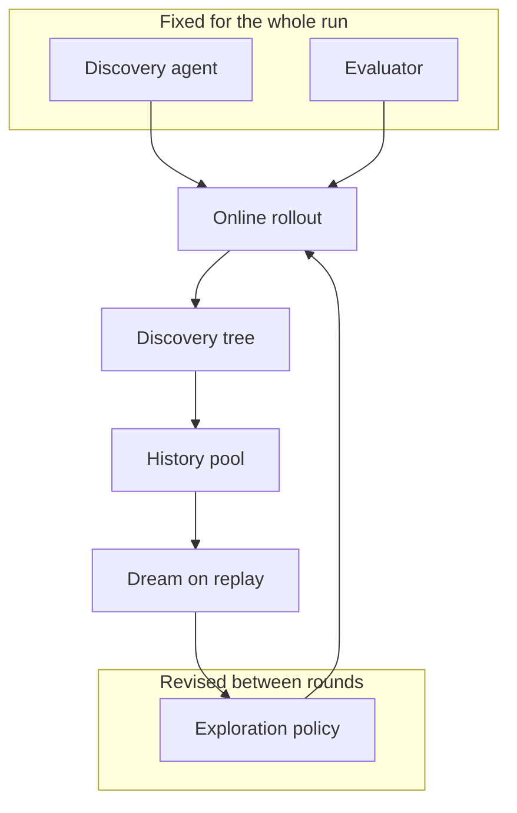
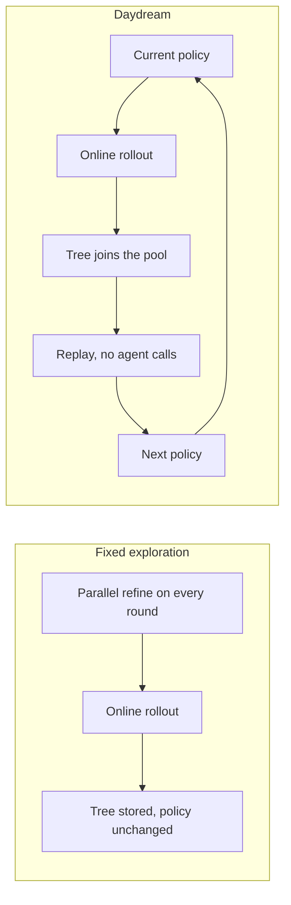
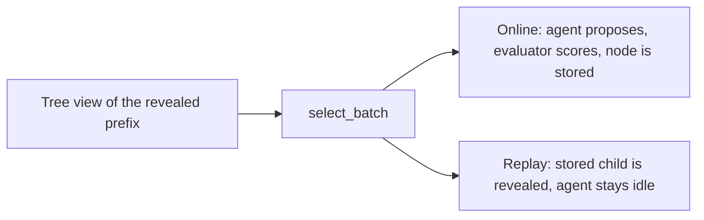
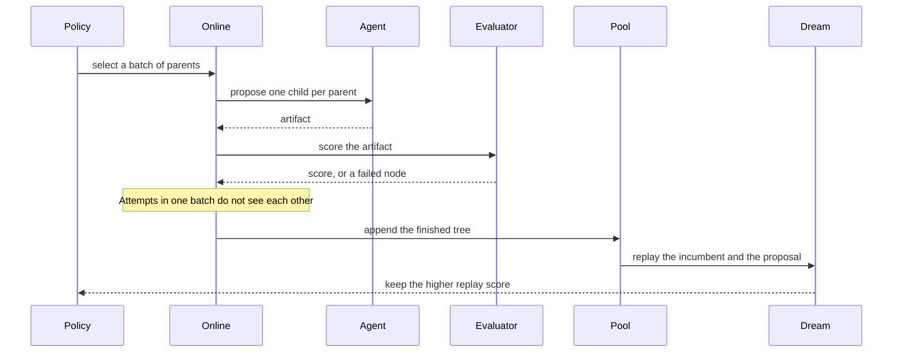
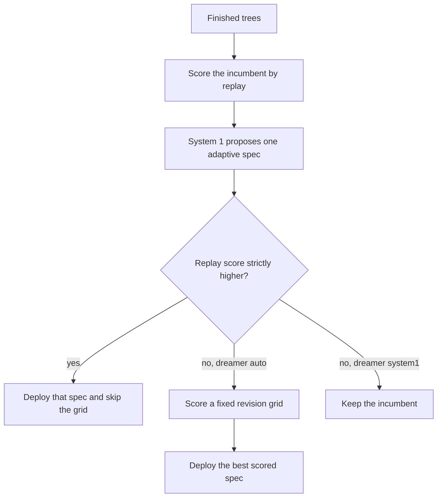
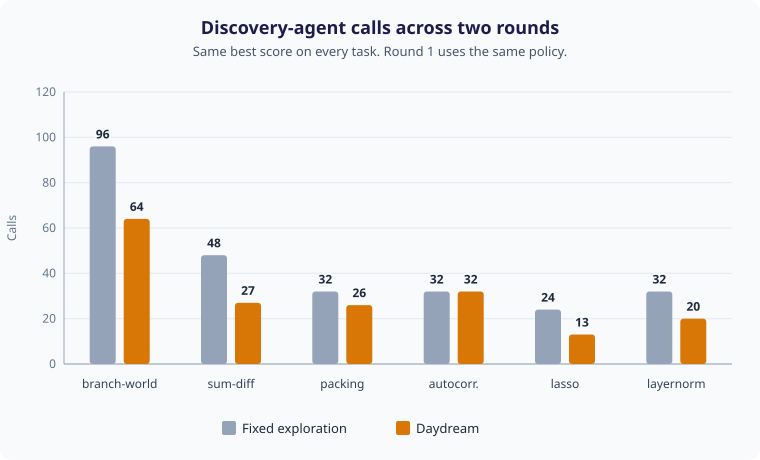
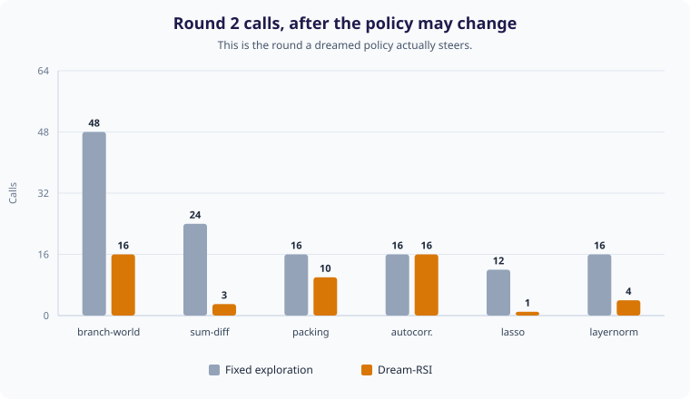

<p align="center">
  
</p>

<h1 align="center">Daydream</h1>

<p align="center">
  An independent implementation of Dream-RSI: improve an exploration policy by replaying discovery trees.
</p>

<p align="center">
  <a href="https://www.python.org/downloads/"></a>
  <a href="LICENSE"></a>
  <a href="https://arxiv.org/abs/2609.14858"></a>
  <a href="https://www.dream-rsi.com"></a>
  
</p>

<p align="center">
  
  
  
  
  
</p>

Paper: [arXiv:2609.14858](https://arxiv.org/abs/2609.14858) · Project page: [dream-rsi.com](https://www.dream-rsi.com) · Upstream notes: [zhengkid/Dream-RSI](https://github.com/zhengkid/Dream-RSI)

Daydream implements the local loop from [Dream-RSI: Recursive Self-Improvement through Evolving Worlds](https://arxiv.org/abs/2609.14858) (Zheng et al., 2026). It is an independent codebase. Cite the paper for the method. The measurements below are from this runner's scripted tasks.

**Tags:** `exploration-policy` `discovery-tree` `replay-simulator` `monotone-selection` `recursive-self-improvement` `system-1` `parallel-refine`

## Technical report

### The architectural change

A search agent usually bundles three jobs: proposing the next artifact, scoring it, and deciding which branch deserves more attempts. Dream-RSI pulls the third job out and makes it the only piece that changes between rounds. Daydream is that split, running locally.

| Role | Across rounds | What it is allowed to do |
| --- | --- | --- |
| Discovery agent | Fixed | Propose one child from a parent. The default agent is scripted by the task. |
| Evaluator | Fixed | Score that child. A raised error is stored as a failed node with score 0. |
| Exploration policy | Revised after each finished round | Choose a batch of parents. It sees the revealed prefix only. |
| Replay simulator | Reads stored trees | Reveal nodes that were already evaluated. It does not call the agent or the evaluator. |

Judging a new policy used to mean another online rollout. Here a finished rollout is a world that has already been paid for. Later policies walk that world. The agent is called again only when a selected policy goes back online and records a new tree.



Fixed exploration holds the round-1 policy constant, so every later round pays the same search again. Daydream appends each finished tree and deploys the policy with the best average replay score. The incumbent is always a candidate, so the deployed policy's replay score is at least as high as the policy it replaces.



Both modes share one decision interface, `select_batch`. Online mode turns each choice into a new evaluated node. Replay mode turns the same choice into a reveal of a node that is already on disk.



### One round

Round 1 always deploys the task's parallel-refine policy: open several branches from the root, then refine each one to a fixed depth. That is the shared baseline in the paper, and it is the shared baseline here.



A tree is a root workspace plus one chain per opened branch. Each non-root node is one generation–evaluation attempt. New branches open from the root. Within a batch, attempts run in selection order so a seed determines the tree, and `max_parallelism` is the batch cap the score treats as parallel workers.

After the tree is stored, the dreamer proposes the next policy. The default dreamer is `auto`.



System 1 does not call a model and does not execute code. It reads branch scores that the rollout already paid for and proposes the smallest adaptive controller that can still uncover every stored world's best node: open branches through the winning branch, stop at the depth where that score first appears, and set patience just high enough that a flat prefix is kept until the payoff. `system1` never searches the grid. `grid` skips the fast proposal and scores the revision schedule. `auto` keeps the fast proposal when it wins and searches the grid otherwise.

An adaptive policy's thresholds stay fixed for the whole rollout. It prunes a branch only after `patience` consecutive steps each gain less than `min_gain`. A branch shorter than that window is kept, which is what lets a late jump survive.

Model output is a JSON policy spec or a JSON artifact. It is not executed as Python. A module you wrote yourself can be loaded from disk; see `examples/narrow_policy.py`.

### The replay score

The score is the Section 3 objective from Zheng et al.:

```text
quality − λ_cost · attempts + λ_parallel · attempts / max(1, rounds)
```

`quality` is the best revealed score. `attempts` is the number of revealed non-root nodes. `rounds` is the number of nonempty decision batches. The defaults are `λ_cost = 0.002` and `λ_parallel = 0.005`.

On the round-1 branch-world tree the two policies reveal the same best score and spend different budgets:

| Policy | Quality | Attempts | Batches | Parallelism | Replay score |
| --- | ---: | ---: | ---: | ---: | ---: |
| `parallel_refine`, width 6, depth 8 | 0.950 | 48 | 8 | 6.0 | 0.884 |
| `adaptive-w4-d4-p3-g0.02` | 0.950 | 16 | 4 | 4.0 | 0.938 |

The arithmetic for the incumbent is `0.950 − 0.002·48 + 0.005·6 = 0.884`. For the adaptive policy it is `0.950 − 0.002·16 + 0.005·4 = 0.938`. Quality is unchanged. The gain is the smaller cost term. Because 0.938 is strictly above 0.884, that spec is what round 2 deploys.

Branch 3 of this world stays at 0.20 for three steps and jumps to 0.95 at depth 4. Patience 3 keeps that prefix. Width 4 still opens the winning branch. Depth 4 stops once the jump is in hand. Flat branches are left behind.

### What the local runs show

The comparison is `daydream compare` at its defaults: two rounds, parallelism 8, dreamer `auto`, the scripted agent, and the lambdas above. Scores below are printed to four decimals, as the command prints them. Both modes reach the same best score on every task. The difference is how many discovery-agent calls round 2 spends.





| Task | Fixed calls | Daydream calls | Best score, both modes | Policy deployed in round 2 |
| --- | ---: | ---: | ---: | --- |
| branch-world | 96 | 64 | 0.9500 | `adaptive-w4-d4-p3-g0.02` |
| sum-diff | 48 | 27 | 1.0344 | `adaptive-w3-d1-p1-g0.02` |
| circle-packing | 32 | 26 | 1.2384 | `adaptive-w3-d4-p1-g0.02` |
| autocorrelation | 32 | 32 | 0.4139 | `parallel_refine` |
| lasso | 24 | 13 | 0.7200 | `adaptive-w1-d1-p1-g0.02` |
| kernel-layernorm | 32 | 20 | 0.0455 | `adaptive-w1-d4-p2-g0.02` |
| **Total** | **264** | **182** |  |  |

Round 1 matches by construction: 48, 24, 16, 16, 12, and 16 calls. Across six tasks Daydream records 182 calls against 264 for fixed exploration, which is 82 fewer agent calls, with the best score held on each task.

Autocorrelation is the case the selection rule is there for. The fast proposal tied the incumbent at replay score 0.401934, so it was declined. The revision grid then scored lower or equal. Round 2 kept parallel-refine and spent the same 16 calls. A proposal is deployed only when replay says it is better.

On branch-world the command prints:

```text
fixed exploration
round   calls     cum      best  policy
    1      48      48    0.9500  parallel_refine
    2      48      96    0.9500  parallel_refine

dream-rsi
round   calls     cum      best  policy
    1      48      48    0.9500  parallel_refine
    2      16      64    0.9500  adaptive-w4-d4-p3-g0.02
```

### What these numbers are

They are the effect of changing the exploration policy on this repository's local evaluators. The agent in the table is the scripted proposer, so the call counts are deterministic. They describe this runner. The paper's Gemini harness, KernelBench GPU runs, and discovered programs are a separate result.

| Piece | In this repository |
| --- | --- |
| Discovery tree, batch decisions, online rollout | Yes |
| Replay simulator and the Section 3 score | Yes |
| Monotone selection over a history pool | Yes |
| Parallel-refine start, and a prefix-only adaptive policy | Yes |
| Fixed-exploration baseline with the same agent, evaluator, and round-1 policy | Yes |
| Sum–difference, circle packing, discretized autocorrelation, a small Lasso path, LayerNorm | Local evaluators, at the sizes in the task table |
| Optional OpenAI-compatible client for an artifact or a policy spec | Yes, and the command line leaves it off |
| The authors' Gemini CLI harness, KernelBench GPU runs, and the discovered C++ solver | Outside this repository |

## Tasks

Every task stores a higher-is-better score. Autocorrelation keeps the autoconvolution peak in diagnostics and stores its inverse.

| Task | Starting policy | What a node is |
| --- | --- | --- |
| `branch-world` | width 6, depth 8 | A didactic score of branch index and depth. Branch 3 pays 0.95 at depth 4. |
| `sum-diff` | width 6, depth 4 | Gamma of a sum-difference set, as in Appendix A. The evaluator recomputes it. |
| `circle-packing` | width 4, depth 4 | Sum of radii for 8 circles in the unit square. Infeasible packings score 0. The paper studies n in {26, 32}. |
| `autocorrelation` | width 4, depth 4 | Inverse peak autoconvolution on a 21-bin grid. |
| `lasso` | width 4, depth 3 | A correct regularization path on one 36×20 design, scored by inverse operation count. |
| `kernel-layernorm` | width 4, depth 4 | A CPU LayerNorm that matches a reference, scored by inverse declared operation cost. |

## Run it

Python 3.11 or newer. The runtime has no third-party packages. Tests use pytest.

```bash
python -m venv .venv
source .venv/bin/activate
pip install -e ".[dev]"

daydream compare --task branch-world --rounds 2
pytest
```

```bash
daydream tasks
daydream run --task sum-diff --rounds 2 --out runs/sum-diff
```

`runs/sum-diff/history/` holds one JSON tree per round. `summary.json` holds the policy that ran, the policy selected for the next round, and the replay scores.

`--dreamer` is `auto`, `system1`, or `grid`. To ask a chat model for the next artifact or the next policy spec, set `OPENAI_API_KEY` and, if needed, `OPENAI_BASE_URL`, and call `LLMAgent` or `propose_policy_spec` in `daydream.agents`. The command line stays on the scripted agent, so a clone runs without a key.

## Layout

| Module | Responsibility |
| --- | --- |
| `daydream.online` | Deploy a policy and record a tree. |
| `daydream.replay` | Reveal a subset of a stored tree and score that walk. |
| `daydream.system1` | Propose one adaptive spec from stored branch scores. |
| `daydream.dream` | Accept that proposal when it wins, otherwise score the revision grid. |
| `daydream.loop` | Alternate online rounds and dreaming, or hold the policy fixed. |
| `daydream.policy` | Parallel-refine and adaptive controllers. Specs are JSON. |
| `daydream.tasks` | Evaluators and the fixed scripted agent. |
| `daydream.agents` | Scripted agent, plus an optional chat client. |

## Assumptions

This is a single-operator local runner.

- A run is one process. History is JSON on disk and fits in memory.
- A round is consistent when it finishes. The tree is appended only after that rollout returns. Replay never sees a partial round.
- Within a decision batch the attempts do not observe each other.
- Replay is exact on the recorded tree and refuses to invent a child that was never evaluated.
- Chat calls, when a caller enables them, have a timeout and retry transport failures only. `OPENAI_API_KEY` stays in the environment.
- A proposal or evaluator that raises is stored as a failed node with score 0, and the run continues.

## Citation

Cite the paper for the method.

```bibtex
@article{zheng2026dreamrsi,
  title   = {Dream-RSI: Recursive Self-Improvement through Evolving Worlds},
  author  = {Zheng, Tong and Wu, Xidong and Zhang, Zheng and He, Zhankui and
             Zhang, Chaoyi and Coleman, Benjamin and Wei, Ruoqiao and Bai, Di and
             Liu, Haolin and Liu, Rui and Wang, Xue and Zhuan, Yue and
             Kang, Wang-Cheng and Xiang, Renkai and Huang, Heng and
             Cheng, Xinwu and Guo, Yunsong},
  journal = {arXiv preprint arXiv:2609.14858},
  year    = {2026}
}
```

## License

MIT. See [LICENSE](LICENSE).
